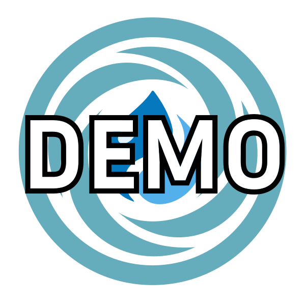

  

<h1 align="center">star wars</h1>

Drupal 11 implementation of star wars for star wars Org

[//]: # (DO NOT REMOVE THE BADGE BELOW. IT IS USED BY VORTEX TO TRACK INTEGRATION)

## Environments

- DEV: https://dev.star-wars.com
- STAGE: https://stage.star-wars.com
- PROD: https://www.star-wars.com

## Local environment setup

- Make sure you have the latest versions of the required software installed:
  [Docker](https://www.docker.com/),
  [Pygmy](https://github.com/pygmystack/pygmy), and
  [Ahoy](https://github.com/ahoy-cli/ahoy).
- Shut down any local web development services, such as Apache, Nginx,
  MySQL, or MAMP.
- Check out the project repository into one of the [supported Docker
  directories](https://docs.docker.com/desktop/settings-and-maintenance/settings/#virtual-file-shares).

- `ahoy fetch-db`

- `pygmy up`
- `ahoy build`

## Project documentation

- [FAQs](docs/faqs.md)
- [Testing](docs/testing.md)

- [CI](docs/ci.md)

- [Deployment](docs/deployment.md)

---
<!-- markdownlint-disable-next-line MD013 -->
_This repository was created using the [Vortex](https://github.com/drevops/vortex) Drupal project template_
