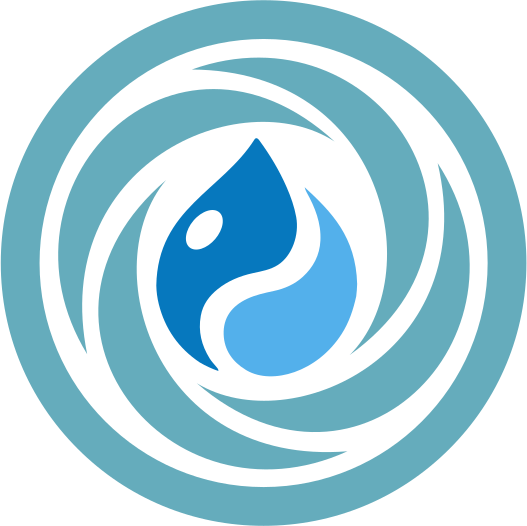
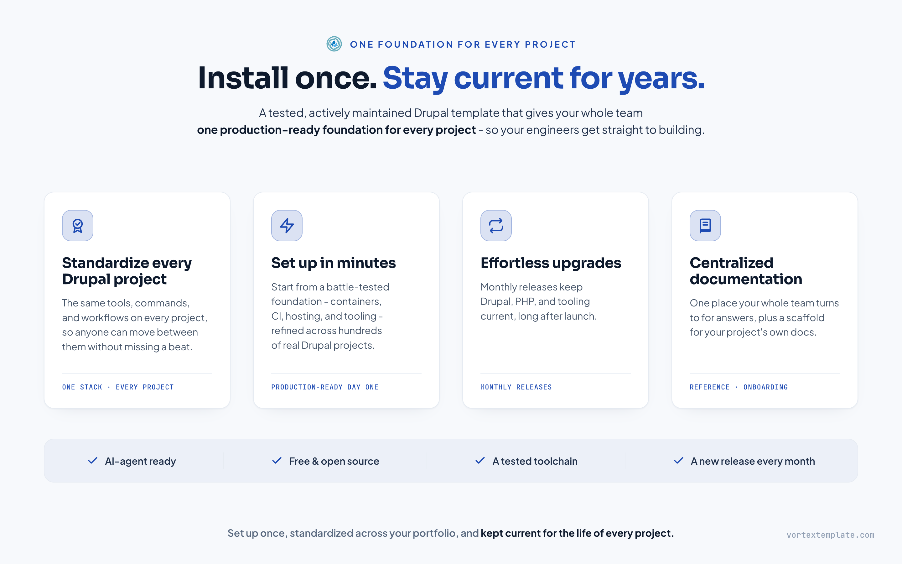

<div align="center">
  <picture>
    <source
      media="(prefers-color-scheme: dark)"
      srcset=".vortex/docs/static/img/logo-vortex-light.svg"
    />
    
  </picture>
</div>

<h1 align="center">Vortex</h1>
<h3 align="center">Drupal project template</h3>

<div align="center">

[](https://github.com/drevops/vortex/actions/workflows/build-test-deploy.yml)
[](https://circleci.com/gh/drevops/vortex)
[](https://github.com/drevops/vortex/actions/workflows/vortex-test-common.yml)
[](https://github.com/drevops/vortex/actions/workflows/vortex-test-docs.yml)
[](https://codecov.io/gh/drevops/vortex)


</div>

**Vortex** is a tested Drupal project template. Your team installs it once
with the features it needs, then pulls in upstream updates for as long as
the project lives.

Every site in your portfolio then looks, builds, tests, and deploys the same
way. New hires start on a familiar stack, and CI and hosting integrations
come pre-configured. **Vortex** has a new release every month, and your
project can adopt the upstream changes through the same installer that set
it up.

<div align="center">
  <picture>
    <source
      media="(prefers-color-scheme: dark)"
      srcset=".vortex/docs/static/img/diagram-dark.png"
    >
    
  </picture>
</div>

## Who Vortex is for

### For CTOs and engineering directors

You need every Drupal project in your portfolio to look, build, and ship the
same way, even when the team that owns it changes. **Vortex** gives you a
tested template, monthly upstream releases, the same CI and hosting
integrations on every site, and paid support you can escalate to.

### For Drupal practice leads and agency principals

Each new client engagement starts with weeks of setup before any billable
feature work begins. **Vortex** turns that setup into a known cost. Your
delivery team picks the features in the installer and starts from an
opinionated baseline it already knows. Every engagement then begins at the
same quality floor.

### For tech leads and engineering managers

You want new hires productive on day 1 and CI that doesn't surprise you a
month later. **Vortex** ships Docker, GitHub Actions, and CircleCI
configurations, code quality tooling, a testing harness, and project context
for AI coding agents, so every team in your organization learns the same
stack.

### For senior Drupal developers

You'd rather write Drupal than look after infrastructure. Every **Vortex**
project has the same `ahoy` commands, containers, and testing scaffolds, so
what you learn on one site carries over to the next.

### For DevOps and platform engineers

You need local, continuous integration, and hosting environments to behave
identically, and dependency updates to arrive on a known schedule.
**Vortex** ships a single provisioning script that runs in every
environment, built-in Acquia and Lagoon integrations, Renovate-driven
dependency updates, and opt-in visual regression gated by a PR label.

## What is inside Vortex

**Vortex** has 3 parts that work together:

- 📦 **Template** - the pre-configured Drupal project: containerized local
  environment (Docker Compose + Ahoy), GitHub Actions and CircleCI
  pipelines, Acquia and Lagoon hosting integrations, code quality tooling
  (PHPCS, PHPStan, Rector, Twig CS Fixer, ESLint), and a testing harness
  (PHPUnit, Behat with screenshot capture).
- 📖 **Documentation** - centralized guidance at
  [vortextemplate.com](https://www.vortextemplate.com), a scaffold for your
  project-specific docs, and an onboarding checklist for new team members.
- 🎛️ **Installer** - a standalone CLI that adds only the features you
  select, renames boilerplate to your project, and upgrades existing
  installations to newer **Vortex** versions.

➡️ See the full [feature list](https://www.vortextemplate.com/docs/features)
and the
[architecture overview](https://www.vortextemplate.com/docs/architecture).

## Day 1, Month 6, Year 3

**Vortex** covers the whole life of a project:

- 🚀 **Day 1** - Run the installer and pick your features to get a Drupal
  site that builds locally, runs in CI, and is ready to deploy to staging.
- 🔧 **Month 6** - Renovate keeps dependencies current, and the provisioning
  script runs the same way for every developer. New hires find the tooling
  already set up, so they don't have to rely on tribal knowledge.
- 🛟 **Year 3** - Monthly **Vortex** releases bring upstream tooling, PHP,
  and Drupal updates. The installer applies them, so your project stays
  current.

## Quick start

```bash
curl -SsL https://www.vortextemplate.com/install > installer.php && php installer.php
```


Alternatively, clone this repository and edit out the sections you don't
need.

➡️ Read the
[installation guide](https://www.vortextemplate.com/docs/installation) for
the full walkthrough.

### Installing with an AI coding agent

The installer supports AI coding agents. Run it with `--agent-help` for full
instructions on programmatic installation:

```bash
curl -SsL https://www.vortextemplate.com/install > installer.php && php installer.php --agent-help
```

### Development version

The latest development build of the installer from the `develop` branch is
at https://vortex-docs.netlify.app/install:

```bash
curl -SsL https://vortex-docs.netlify.app/install > installer.php && php installer.php
```

## See Vortex in production

The [DrevOps website](https://github.com/drevops/website) is a production
Drupal site built on **Vortex**. It receives regular upstream updates and
shows what a long-lived **Vortex** project looks like: CI configuration,
testing workflows, and the update routine teams run between releases. Use it
as a reference for structuring your own **Vortex**-based site.

## Documentation

The full **Vortex** documentation lives at
[https://www.vortextemplate.com](https://www.vortextemplate.com). Good
starting points:

- [Architecture](https://www.vortextemplate.com/docs/architecture) - how the
  pieces fit together
- [Features](https://www.vortextemplate.com/docs/features) - the full
  feature list
- [Installation](https://www.vortextemplate.com/docs/installation) - install
  into a new or existing project
- [Updating Vortex](https://www.vortextemplate.com/docs/updating-vortex) -
  pull in upstream releases
- [FAQs](https://www.vortextemplate.com/docs/faqs) - quick answers to common
  questions

Documentation is authored under [`.vortex/docs`](.vortex/docs) in this
repository and published on each **Vortex** release. The latest development
preview is at
[https://vortex-docs.netlify.app/](https://vortex-docs.netlify.app/).

For a high-level overview, see the
[DrupalSouth 2025 presentation][presentation]
([Google Slides][slides] | [PDF][pdf]).

[presentation]: https://docs.google.com/presentation/d/e/2PACX-1vQMBTteMr6cALYGtI3xwqvt9HFpzSzTsV3ie5qhVMPK5eSZBudyQp7H1_Wfoy7HMYqfgN2ooH4rlWJL/pub?start=false&loop=false&delayms=5000
[slides]: https://docs.google.com/presentation/d/1nsFfd9C_ddKD5O0sQeJ8_6pJjU0XWaXXwDmD0SwCIL4/
[pdf]: https://docs.google.com/presentation/d/1nsFfd9C_ddKD5O0sQeJ8_6pJjU0XWaXXwDmD0SwCIL4/export/pdf

## Releases and roadmap

**Vortex** ships a release every month. Subscribe to GitHub releases or
follow the
[updating guide](https://www.vortextemplate.com/docs/updating-vortex) to
keep your project current.

- [Project development
  board](https://github.com/orgs/drevops/projects/2/views/1)
- [Project planning
  board](https://github.com/orgs/drevops/projects/2/views/3)

## Support

Paid support for **Vortex** covers:

- New and existing project onboarding
- Support plans with SLAs
- Priority feature implementation
- Updates to the latest version of **Vortex**
- Custom implementations and consulting

Email [support@drevops.com](mailto:support@drevops.com).

Community support is on the
[`#vortex-project-template`](https://drupal.slack.com/archives/CRE86HQTW)
channel in Drupal Slack and on
[GitHub Issues](https://github.com/drevops/vortex/issues).

## Contributing

See the
[contributing guide](https://www.vortextemplate.com/docs/contributing) for
how to get involved.

## License

**Vortex** is licensed under
[GPL-3.0](https://www.gnu.org/licenses/gpl-3.0.en.html). See
[LICENSE](LICENSE) for details.
